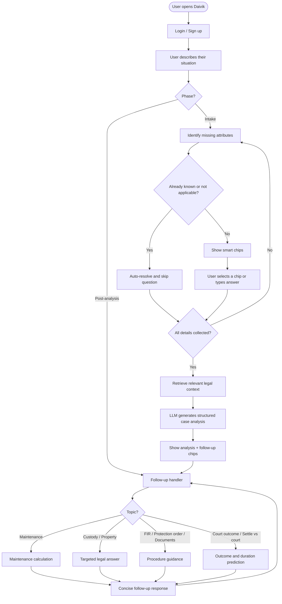
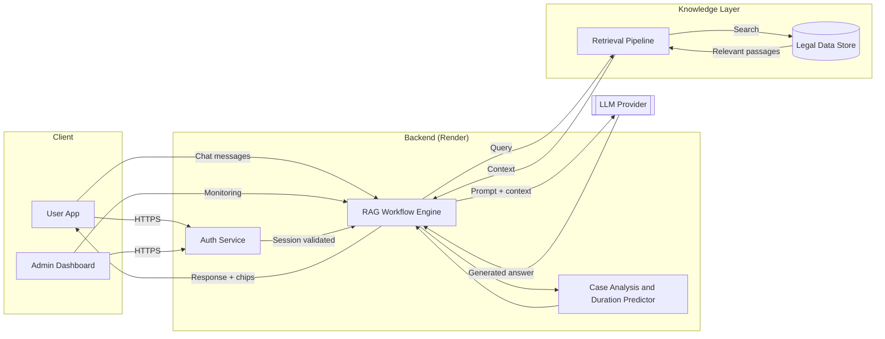
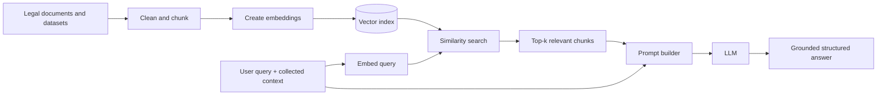
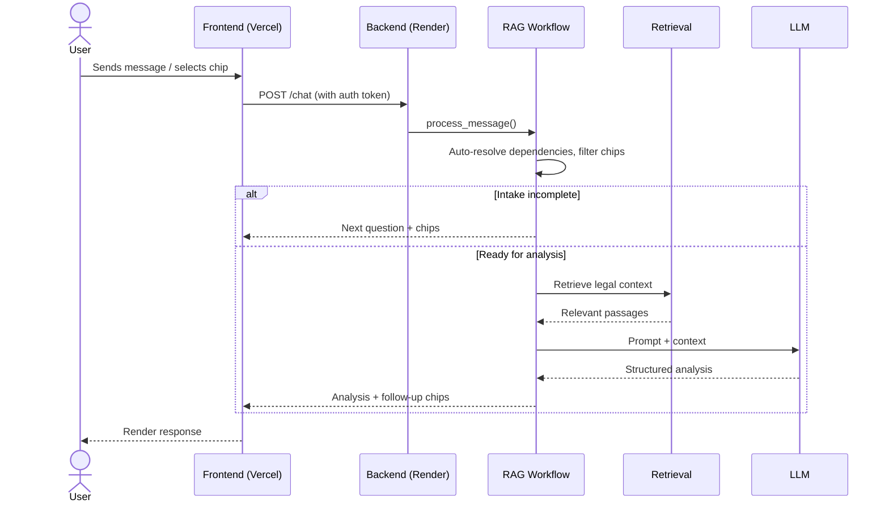

<h1 align="center">⚖️ Daivik</h1>

<p align="center">
  <b>An AI-powered legal guidance assistant built on Retrieval-Augmented Generation (RAG)</b><br/>
  Helping people understand their legal situation, rights and next steps, in plain language.
</p>

<p align="center">
  
  
  
  
  
</p>

---

## 📖 About

**Daivik** is a conversational legal assistant that guides users through their situation step by step. Instead of dumping generic legal text, it asks smart, context-aware questions, retrieves relevant legal information from its knowledge base, and produces a structured analysis, followed by focused follow-up help.

It is designed especially for sensitive, family-law related situations such as maintenance/alimony, child custody, protection orders and filing complaints, where people often don't know where to begin.

> ⚠️ **Disclaimer:** Daivik provides general legal information, not legal advice. Always consult a qualified lawyer for your specific case.

---

## ✨ Features

- 💬 **Guided conversation:** smart "chip" questions that adapt to the user's answers (e.g. income questions are skipped when they don't apply)
- 🔍 **RAG-based retrieval:** answers grounded in a legal knowledge base rather than guesswork
- 📄 **Structured case analysis:** a clear breakdown of the user's situation after the intake phase
- 🔁 **Smart follow-ups:** concise, targeted answers after analysis, with quick actions such as:
  - Calculate maintenance / alimony
  - Predict court outcome
  - Settle vs. go to court
  - Child custody advice
  - Documents needed
  - How to file an FIR / complaint
  - Property rights
  - Protection order process
- ⏱️ **Case duration prediction:** estimates how long a case may take
- 🔐 **Authentication:** user login and accounts
- 🛠️ **Admin dashboard:** manage and monitor the platform
- 📊 **RAG evaluation:** scripts to measure retrieval and answer quality

---

## 🗂️ Project Structure

```
Daivik/
├── app/                  # Main user-facing application
├── auth_app/             # Authentication + backend services (RAG workflow)
├── admin-dashboard/      # Admin panel
├── case_analysis/        # Case analysis & prediction logic
├── retrieval/            # Retrieval pipeline for the RAG system
├── data/                 # Legal knowledge base / datasets
├── evaluate_rag.py       # RAG evaluation script
├── test_bot.py           # Chatbot tests
├── test_duration_predictor.py  # Duration predictor tests
├── render.yaml           # Render deployment config
├── vercel.json           # Vercel deployment config
└── implementation_plan.md
```

---

## 🧠 How It Works

### Conversation Flow



### System Architecture



### RAG Pipeline



### Request Sequence



> The diagrams are based on the repository structure and `implementation_plan.md`. Adjust component names, endpoints and the vector store to match your actual implementation.

---

## 🧱 Tech Stack

| Layer | Technology |
|-------|------------|
| Language | Python |
| AI / NLP | Retrieval-Augmented Generation, LLM API |
| Backend | Python service in `auth_app/backend`, hosted on Render |
| Frontend | Web app and admin dashboard, hosted on Vercel |
| Knowledge base | Legal datasets in `data/`, indexed by `retrieval/` |
| Testing | `test_bot.py`, `test_duration_predictor.py`, `evaluate_rag.py` |

---

## 🔬 Detailed Explanation

### 1. The Problem
Most people facing a family-law problem (maintenance, custody, domestic violence, divorce) do not know which law applies, what documents they need, or what to do first. Generic chatbots tend to give long, unfocused answers and can hallucinate legal provisions. Daivik tackles this with a guided, retrieval-grounded approach.

### 2. Intake Phase: Smart Chips
Instead of asking users to write everything in one message, Daivik collects details through short tappable options ("chips").

- Each case needs a set of **attributes** (for example income, financial dependency, marital status, children).
- `_filter_chips` and `_should_skip` decide which questions are still relevant.
- `_auto_resolve_dependencies` fills in dependent attributes automatically. For example, if the user picks *"Housewife / No income"*, the system does not ask "What is your monthly income?" again.
- The result is a shorter, more logical conversation with fewer irrelevant questions.

### 3. Retrieval Phase: Grounding in Legal Text
Once enough context is collected, the `retrieval/` module searches the legal knowledge base in `data/` and returns the most relevant passages. These are passed to the LLM together with the user's case details, so the answer is based on retrieved material rather than the model's memory alone.

### 4. Analysis Phase: Structured Output
The LLM produces a structured case analysis. The case analysis module (`case_analysis/`) adds estimates such as likely outcome and expected case duration.

### 5. Follow-up Phase
After the analysis, Daivik switches to a lighter follow-up mode with its own concise prompt:
- Answers only the specific question asked
- Does not regenerate the whole analysis unless the user asks
- Always allows the maintenance / alimony calculation
- Offers quick-action chips for common next steps (documents, FIR, protection order, property rights, settle vs. court)

### 6. Design Decisions

| Decision | Reason |
|----------|--------|
| Chips instead of free text for intake | Faster on mobile, less ambiguity, easier to validate |
| Dependency-aware questions | Avoids illogical questions and keeps the user comfortable |
| RAG instead of a plain LLM | Reduces hallucination and keeps answers traceable to sources |
| Separate follow-up prompt | Shorter, more useful replies after the first analysis |
| Separate admin dashboard | Lets maintainers monitor usage and quality without touching the user app |

---

## 📊 Evaluation & Results

Daivik is evaluated on two levels: **retrieval quality** (did we find the right legal text?) and **answer quality** (is the final answer correct, relevant and grounded?). The evaluation is run with `evaluate_rag.py`.

### Metrics Used

| Metric | Stage | What it measures |
|--------|-------|------------------|
| **Recall@k** | Retrieval | Share of the relevant documents or passages found in the top-k retrieved results |
| **Precision@k** | Retrieval | Share of the top-k retrieved results that are actually relevant |
| **MRR** (Mean Reciprocal Rank) | Retrieval | How high the first relevant result appears in the ranking |
| **ROUGE-1 / ROUGE-2** | Generation | Word and bigram overlap between the generated answer and a reference answer |
| **ROUGE-L** | Generation | Longest common subsequence overlap, which reflects sentence-level structure |
| **Accuracy** | Classification | Share of correct predictions (for example outcome prediction, topic or intent routing) |
| **F1-score** | Classification | Balance of precision and recall, useful when classes are uneven |
| **Faithfulness** | Generation | Whether the answer is supported by the retrieved context (hallucination check) |
| **Answer relevancy** | Generation | Whether the answer actually addresses the question |
| **MAE** (Mean Absolute Error) | Duration predictor | Average error, in months, of predicted case duration |

### Results

> ⚠️ **Replace the `—` values below with the numbers printed by your own `evaluate_rag.py` run.** Do not publish figures you have not measured.


### How to Reproduce

```bash
pip install rouge-score scikit-learn ragas datasets
python evaluate_rag.py
```

Minimal example of how these scores are computed:

```python
from rouge_score import rouge_scorer
from sklearn.metrics import accuracy_score, f1_score

# --- ROUGE: generated answer vs reference answer ---
scorer = rouge_scorer.RougeScorer(["rouge1", "rouge2", "rougeL"], use_stemmer=True)
scores = scorer.score(reference_answer, generated_answer)
print({k: round(v.fmeasure, 3) for k, v in scores.items()})

# --- Recall@k: relevant docs found in the top-k results ---
def recall_at_k(relevant_ids, retrieved_ids, k):
    hits = len(set(relevant_ids) & set(retrieved_ids[:k]))
    return hits / len(relevant_ids)

# --- Accuracy and F1 for classification tasks ---
accuracy = accuracy_score(y_true, y_pred)
f1 = f1_score(y_true, y_pred, average="weighted")
```

### Reading the Results
- **High Recall@k, low ROUGE:** retrieval works but the prompt or generation needs tuning.
- **Low Recall@k:** improve chunking, embeddings or the knowledge base before touching the prompt.
- **High ROUGE, low faithfulness:** the answer looks right but is not supported by the retrieved text, which is a hallucination risk in a legal setting.
- ROUGE measures wording overlap, not legal correctness, so it should be read together with faithfulness and manual review by a legal expert.

---

## 🚀 Getting Started

### Prerequisites
- Python 3.10+
- Node.js (for the frontend / dashboard)
- API key(s) for your LLM provider (see `.env.README.md`)

### Setup

```bash
# 1. Clone the repository
git clone https://github.com/SohamRangdal88/Daivik.git
cd Daivik

# 2. Create a virtual environment
python -m venv venv
source venv/bin/activate        # Windows: venv\Scripts\activate

# 3. Install dependencies
pip install -r requirements.txt

# 4. Configure environment variables
#    See .env.README.md for the required keys

# 5. Run the backend
cd auth_app/backend
# start your server here (e.g. uvicorn main:app --reload)
```

### Run tests

```bash
python test_bot.py
python test_duration_predictor.py
python evaluate_rag.py
```

---

## ☁️ Deployment

- **Backend:** Render (`render.yaml`)
- **Frontend:** Vercel (`vercel.json`)

---

## 🛣️ Roadmap

- [x] Guided intake with dependent questions
- [x] Structured case analysis
- [x] Post-analysis follow-up chips
- [ ] Multi-language support
- [ ] Document generation (draft complaints / applications)
- [ ] Expanded legal knowledge base

---

## 🤝 Contributing

Contributions, issues and feature requests are welcome. Feel free to open an issue or submit a pull request.

---

## 👤 Author

**Soham Rangdal**
GitHub: [@SohamRangdal88](https://github.com/SohamRangdal88)

---

<p align="center">Made with ❤️ to make legal help more accessible.</p>
